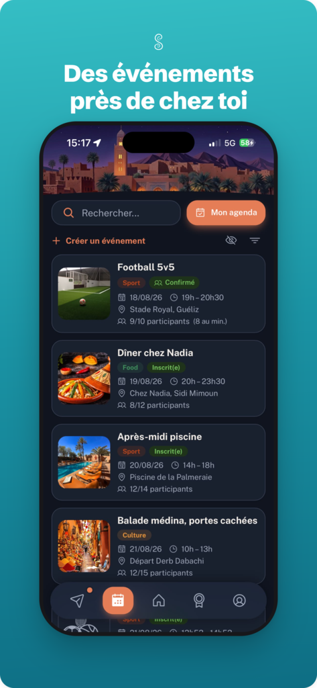
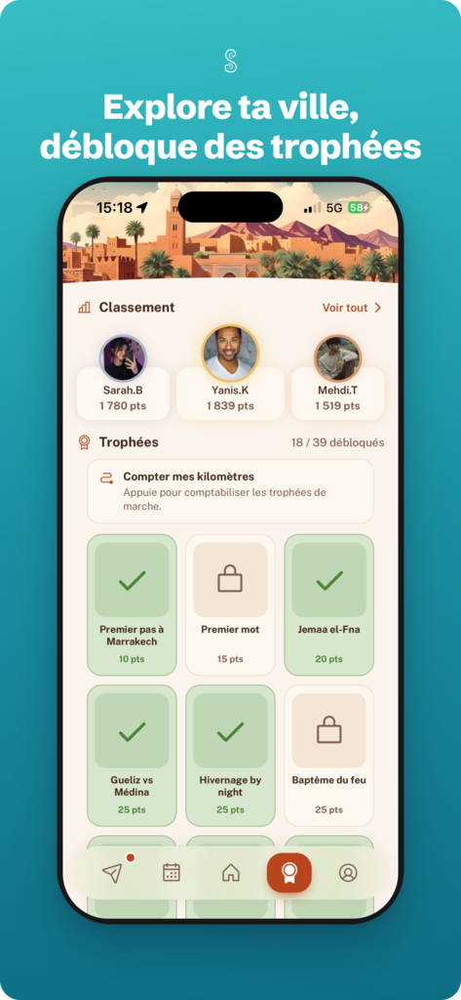

# Sirocco · la partie données

**Sirocco** est une application mobile qui aide les Français installés à l'étranger, et les
étudiants d'une même école, à se rencontrer autour d'événements : un café, un match, une
soirée de révisions. Chaque ville a sa propre communauté. Elle est en ligne depuis l'été 2026,
avec près de 50 membres répartis entre Marrakech, Paris, Londres, Barcelone, Berlin et l'ESSEC.

Ce dépôt rassemble **trois extraits du vrai code de l'application**, ceux qui touchent aux
données, avec leurs tests. Le reste de l'application (écrans, messagerie, appels…) reste privé :
je peux le montrer sur demande.

<p align="center">
  
  
  
  
</p>

---

## 1. Recommandation : montrer à chacun ce qui l'intéresse d'abord

📁 [`recommandation/`](recommandation)

**Le problème.** Quand une ville publie plus que ce qu'on peut lire d'un coup, l'ordre des
dates ne suffit plus : on rate le post de son ami au milieu de vingt autres.

**La solution.** Chaque post reçoit une note, différente pour chaque membre :

- **la fraîcheur** : un post perd la moitié de sa note toutes les 30 heures. Une question posée
  il y a une heure passe devant un post d'ami vieux de cinq jours ;
- **la proximité** : la note monte si l'auteur est un ami, quelqu'un croisé à un événement, ou
  quelqu'un dont on aime souvent les posts, et si le post parle de sujets qu'on lit en entier ;
- **l'intérêt général** : les likes et les commentaires comptent un peu, et un post déjà vu
  plusieurs fois descend.

Deux garde-fous pour ne pas enfermer les gens dans ce qu'ils connaissent déjà :

- **une place sur quatre est réservée à la découverte** : le post le plus récent qu'on n'a
  jamais vu, quel que soit son auteur. Sans elle, un nouveau membre ne serait jamais lu ;
- **un même auteur ne prend jamais trois places de suite.**

Le même principe propose trois événements « pour toi » : la catégorie qu'on fréquente, un
organisateur qu'on apprécie, des amis déjà inscrits, le moment de la semaine où l'on sort.

**Deux choix assumés.** Le classement ne s'active que quand la ville publie au moins 20 posts
en 48 heures : en dessous, tout le monde voit tout et l'ordre des dates est plus clair. Et tout
se calcule **sur le téléphone** : ce que chacun lit ne quitte jamais son appareil.

Les 19 tests de [`classement.test.ts`](recommandation/classement.test.ts) vérifient chacune de
ces règles.

---

## 2. Campus : remettre chaque salle dans son bâtiment

📁 [`campus/`](campus)

**Le problème.** Pour l'ESSEC, l'application affiche le campus en 3D, construit à partir
d'OpenStreetMap, et on y place un événement dans l'une des 429 salles. Leur position vient des
plans d'étage de l'école, calés à quelques mètres près : un cinquième des salles tombaient dans
une cour ou contre un mur, dehors.

**La solution.** Pour chaque salle, le programme vérifie si elle est dans un bâtiment (test du
point dans un polygone). Sinon, il cherche le mur le plus proche, à moins de 15 mètres, et pose
la salle 1,5 mètre derrière lui, à l'intérieur. Les patios et les parvis, qui sont dehors par
nature, ne bougent pas. Les 5 tests de [`ramener.test.mjs`](campus/ramener.test.mjs) en
montrent les cas.

---

## 3. Points et trophées : récompenser sans qu'on puisse tricher

📁 [`points/`](points)

**Le problème.** Les membres gagnent des points et des trophées en sortant. Si le téléphone les
calculait lui-même, n'importe qui pourrait s'en donner.

**La solution.** Tout est calculé par le serveur, et seulement à partir de **faits qu'un membre
ne peut pas fabriquer seul** : sa présence est validée par l'organisateur (billet scanné ou case
cochée), jamais par la simple inscription. Ensuite :

- chaque attribution a une **clé unique** : si le serveur rejoue un calcul, rien n'est payé
  deux fois ;
- des **plafonds** : 200 points par jour au plus, et deux amis qui sortent chaque semaine ne
  « se rencontrent » qu'une fois par mois ;
- un événement en ligne ne rapporte rien, puisqu'on ne s'y est pas vu.

Le [barème](points/bareme.ts) et le [moteur](points/moteur.ts) sont vérifiés par 14 tests qui
tournent contre une vraie base de données, lancée en local.

---

## Lancer les tests

```bash
npm install
npm test             # recommandation et campus
npm run test:points  # moteur de points, avec l'émulateur Firebase (demande Java)
```

## Technologies

TypeScript · Node.js · Vitest · Firebase (Realtime Database, Cloud Functions) · OpenStreetMap.
L'application complète utilise aussi React, Capacitor (iOS et Android), MapLibre et three.js.

---

Idris El Hannach · M1 Sciences des données (SCDI), Sorbonne Université & ISUP ·
idriselhannach@gmail.com
